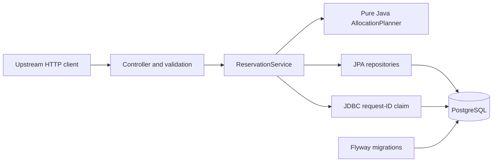

# Stock Reservation API — implementation plan

**Research date:** 30 October 2026  
**Stage:** Research and implementation specification; application implementation follows this plan.  
**License:** MIT.  
**Repository name:** `stock-reservation-api`.  
**Project title:** Stock Reservation API.

Start with the [selected decisions](#2-decisions-fixed-by-the-research), [machine readiness](#3-local-machine-readiness), [transaction design](#7-transaction-and-concurrency-design), [verification plan](#9-verification-plan), and [implementation checkpoints](#12-ordered-implementation-checkpoints). The [acceptance checklist](#13-final-acceptance-checklist) defines the finished result.

## 1. Purpose and completion boundary

Build a small Java service that answers one business question:

> Can we reserve the requested number of cases from suitable stock batches without allocating the same stock twice?

An upstream order system can create a reservation, inspect it, and release it. The engineering depth comes from deterministic allocation, database accounting, overlapping requests, durable idempotency, rollback, and troubleshooting.

The deliverable is a working local application and a public, reviewer-ready GitHub repository. There is no cloud deployment. GitHub Actions runs verification; it does not deploy anything.

### Fixed scope

- One Java application, one Maven module, one PostgreSQL database.
- Exactly three **business** endpoints and three **business** tables. Flyway's schema-history table and an operational health endpoint are supporting infrastructure.
- One warehouse, one SKU per reservation, whole cases only.
- A reservation may allocate across several batches of its SKU.
- Two states: `ACTIVE` and `RELEASED`; no automatic expiration.
- Inventory is seeded. Batch IDs, SKUs, last usable dates, and on-hand quantities are immutable during a scenario. Only reserved counters change.
- FEFO means ascending last usable date, then ascending batch ID.
- No frontend, authentication system, receiving, picking, shipping, stock adjustment, order management, multi-warehouse support, message broker, cache, or distributed transaction.
- No Kubernetes, cloud infrastructure, or mandatory Jenkins installation.

The unauthenticated API is a local learning component. Bind the app and published database port to loopback. Public source availability does not mean the service is intended to be publicly exposed.

### What the project demonstrates

| Area | Evidence in the finished repository |
|---|---|
| Java | A pure allocation planner, records for DTOs, explicit types, collections, and testable time |
| Spring | Constructor injection, validation, HTTP error handling, and service transaction boundaries |
| Hibernate | Mappings, managed entity changes, explicit fetches, flush behavior, and schema validation |
| SQL/PostgreSQL | Constraints, indexes, row locks, atomic uniqueness claims, and diagnostic queries |
| Integration | A precise retry contract and stable request identity across restarts |
| Testing | Unit tests plus PostgreSQL integration, concurrency, rollback, and HTTP tests |
| Support | Correlated logs, a reproducible accounting defect, and an evidence-based incident report |
| Architecture | A short decision record explaining guarantees, assumptions, and alternatives |

### Naming and presentation rules

Use the generic title and repository name above. Use Maven coordinates `io.github.fullstacknick:stock-reservation-api`, base package `io.github.fullstacknick.stockreservation`, and application name `stock-reservation-api`.

Describe an independent educational project with fictional inventory and order references. Do not introduce employer references, product branding, affiliation claims, copied product names, logos, job-posting links, or marketing slogans. Apply this rule to source, documentation, examples, Git history, repository metadata, and release text. The supplied draft is superseded by this document and should not be copied into Git history.

## 2. Decisions fixed by the research

| Decision | Selected direction and reason |
|---|---|
| Java | Java 21, retaining the original learning target and the installed LTS toolchain |
| Framework | Spring Boot **4.1.2**, the stable Initializr default verified during research |
| Build | Maven Wrapper **3.3.4**, downloading Maven **3.10.0**; commit both wrapper scripts and configuration |
| Persistence | Spring Data JPA/Hibernate for entities; a narrow JDBC repository for the request-ID claim |
| Database | PostgreSQL **18.6**, image `postgres:18.6-bookworm`, shared by Compose and Testcontainers |
| Schema | Flyway migrations; Hibernate `ddl-auto=validate`; no automatic schema updates |
| Isolation | Explicit `READ_COMMITTED` for write use cases |
| Concurrency | Pessimistic row locks, acquired in one consistent order |
| Idempotency | A unique external request ID claimed in the reservation table within the allocation transaction |
| Time | Injected `Clock`; warehouse zone `Europe/Berlin`; fixed clock only in demo and tests |
| Tests | Boot-managed JUnit Jupiter, AssertJ, Mockito, and Testcontainers; real PostgreSQL for database behavior |
| API documentation | Checked-in OpenAPI 3.1 document plus runnable HTTP examples; no runtime documentation dependency |
| Errors | Spring `ProblemDetail`, `application/problem+json`, and stable project error codes |
| Logging | SLF4J/Logback with structured key/value fields and one completion event per HTTP attempt |
| Local execution | Java process on the host; PostgreSQL in Docker Compose |
| CI | GitHub Actions on `ubuntu-24.04`, Temurin 21, and the same Maven verification command as local development |
| Public delivery | Public personal repository under `fullstack-nick`; MIT; English documentation |

Spring Boot 4.1.2 supports Java 21 and Maven 3.10.0. The choice was checked against the [system requirements](https://docs.spring.io/spring-boot/system-requirements.html), [Initializr metadata](https://start.spring.io/metadata/client), and an actual local build. Maven 3.10.0 is the stable release listed by [Apache Maven](https://maven.apache.org/download.cgi). PostgreSQL 18 is a supported stable major version; see its [version policy](https://www.postgresql.org/support/versioning/).

### Dependency policy

Use `spring-boot-starter-parent:4.1.2` and let its dependency management select compatible framework and test versions. The verified BOM resolves Hibernate `7.4.13.Final`, Flyway `12.4.0`, PostgreSQL JDBC `42.7.14`, Testcontainers `2.0.5`, JUnit Jupiter `6.0.3`, and Jackson `3.1.7`. Do not independently override these libraries or copy Spring Boot 3/Jackson 2 configuration examples without checking compatibility. [Managed dependencies](https://docs.spring.io/spring-boot/appendix/dependency-versions/coordinates.html).

Runtime dependencies:

- `org.springframework.boot:spring-boot-starter-webmvc`
- `org.springframework.boot:spring-boot-starter-validation`
- `org.springframework.boot:spring-boot-starter-data-jpa`
- `org.springframework.boot:spring-boot-starter-flyway`
- `org.springframework.boot:spring-boot-starter-actuator`
- `org.flywaydb:flyway-database-postgresql`
- `org.postgresql:postgresql` with runtime scope

Test dependencies use Boot 4's matching `spring-boot-starter-webmvc-test`, `spring-boot-starter-data-jpa-test`, `spring-boot-starter-validation-test`, `spring-boot-starter-flyway-test`, and `spring-boot-starter-actuator-test`, plus `spring-boot-testcontainers`, `org.testcontainers:testcontainers-junit-jupiter`, and `org.testcontainers:testcontainers-postgresql`. Generate the baseline with Initializr and remove unused generated examples. Testcontainers 2 uses `org.testcontainers.postgresql.PostgreSQLContainer`. [PostgreSQL module](https://java.testcontainers.org/modules/databases/postgres/).

Use the Boot-managed Surefire and Failsafe versions (`3.5.6` in the verified parent). Add JaCoCo `0.8.16` for a local/CI HTML coverage report. Coverage is supporting evidence; the required behavior matrix below is the acceptance gate. Avoid extra build systems, Lombok, mapping frameworks, and architectural framework dependencies.

Pin the database image to the verified manifest digest for `postgres:18.6-bookworm` when writing configuration:

```text
postgres@sha256:5c4783a8cc3f0074912164f94dfa1be4e043438f0f707cf968d7af9a0d31a2c8
```

This is the multi-platform registry manifest inspected during research; it differs from the older digest associated with the machine's cached tag. Use this **digest-only reference** in Compose and `DockerImageName.parse(...)`, with an adjacent comment recording `18.6-bookworm`. Testcontainers 2.0.5's parser rejects the combined `name:tag@sha256:...` form as an incompatible repository name; the compatibility probe exposed this and the [parser source](https://raw.githubusercontent.com/testcontainers/testcontainers-java/2.0.5/core/src/main/java/org/testcontainers/utility/DockerImageName.java) confirms the cause. Do not bypass image compatibility checks. Dependencies remain fixed for the implementation pass; deliberate updates must pass the full suite.

## 3. Local machine readiness

The following was inspected on 30 October 2026. No application repository existed at the start.

| Requirement | Observed | Action |
|---|---|---|
| OS | Windows 11 Pro, x64; PowerShell 7.6.5 | Ready; document Windows and POSIX commands |
| Java/Javac | Temurin 21.0.10; both on PATH; `JAVA_HOME` points to the JDK | Works; a routine update to current Java 21 patch 21.0.13 is recommended, not a build blocker |
| Git | 2.53.0 | Ready |
| GitHub CLI | 2.88.1; authenticated as `fullstack-nick` | Ready for repository creation and push |
| Docker | Desktop 4.88.1; engine 29.7.2; Linux engine reachable | Ready |
| Compose | 5.4.0 | Ready; use `docker compose`, not legacy `docker-compose` |
| WSL | WSL 2 configured; Docker's Linux engine works | No extra Linux installation required |
| Maven | No global `mvn`; wrapper downloaded and ran Maven 3.10.0 successfully | No global installation needed |
| PostgreSQL/psql | No host `psql`; PostgreSQL 18.6 image available | Use containerized PostgreSQL and `docker compose exec db psql` |
| Ports | No listener observed on host 8080 or 5432 | Recheck at startup; allow configurable ports |
| Capacity | About 32 GiB RAM and 84 GiB free system-drive space | Adequate for this project |
| Network | Initializr and Maven Central reachable; GitHub authentication verified | First clean build may download dependencies/images |

**Readiness conclusion:** no mandatory new machine-level dependency installation was identified. Maven Wrapper, Java dependencies, and containers are project-managed downloads. Docker Desktop must remain available while running the full tests.

### Compatibility experiment already completed

A disposable project outside this repository used the chosen Java/Maven/Boot/PostgreSQL versions. The initial Surefire run and the final Failsafe run each passed the same **2 tests, 0 failures, 0 errors, 0 skips** with Maven `verify`. The final configuration uses the pinned registry digest, Failsafe 3.5.6, JaCoCo 0.8.16, and an explicit Mockito test agent. It established that:

1. Testcontainers can discover the Windows Docker engine and start PostgreSQL 18.6.
2. Flyway can create a schema and Hibernate can validate a mapped entity against it.
3. `JdbcTemplate` and JPA use the same PostgreSQL backend connection under `JpaTransactionManager`.
4. `INSERT ... ON CONFLICT DO NOTHING RETURNING` works through the selected JDBC driver.
5. A real JDBC insert and a flushed JPA insert both disappear after the transaction throws and rolls back.

This is environment and integration evidence, not evidence that the future reservation implementation is correct. The business tests remain implementation deliverables. No project application code or machine-wide configuration was installed by this experiment.

## 4. Business rules and exact HTTP contract

### Rules

1. Requested quantity is a positive integer number of cases.
2. A batch is eligible when `last_usable_on >= required_on`; both dates are inclusive.
3. For a **new** reservation, `required_on` must be today or later in the warehouse zone. A successful replay bypasses this moving-date check.
4. Eligible batches are allocated by `(last_usable_on, id)` ascending, including deterministic ties.
5. Allocation is all or nothing. Insufficient eligible stock leaves no reservation, allocations, or stock-counter changes.
6. Only a successful creation establishes a durable external request ID. Failed attempts can be retried after conditions change.
7. The same successful external request ID with the same SKU, quantity, and required date returns the existing reservation with one stock effect.
8. Reusing that ID with different business input returns a conflict and changes nothing.
9. Release is idempotent. Repeated or concurrent releases restore availability exactly once.
10. Replaying creation after release returns the same `RELEASED` reservation. A new allocation requires a new external request ID.
11. A reservation changes availability, not physical on-hand stock.
12. Active reservations do not expire automatically, even after their required date or a batch's usable date passes. Explicit release remains valid.

### Endpoints

| Method and route | Success | Meaning |
|---|---|---|
| `POST /reservations` | `201 Created` | Newly committed reservation |
| `POST /reservations` with a successful duplicate ID | `200 OK` | Existing reservation in its current state |
| `GET /reservations/{id}` | `200 OK` | Persisted reservation and original allocations |
| `POST /reservations/{id}/release` | `200 OK` | Released reservation, including repeated release |

`GET /actuator/health` is the only operational endpoint exposed. No list, stock-edit, reset, or failure-injection HTTP endpoint is added.

Creation accepts `Content-Type: application/json`:

```json
{
  "externalRequestId": "ORDER-1042-L1",
  "sku": "YOGURT-CASE",
  "quantity": 9,
  "requiredOn": "2026-11-02"
}
```

| Field | Contract |
|---|---|
| `externalRequestId` | Required string, 1–64 ASCII characters, regex `[A-Za-z0-9][A-Za-z0-9._:-]{0,63}`; globally unique across this single-warehouse service |
| `sku` | Required string, 1–64 ASCII characters, regex `[A-Z0-9][A-Z0-9_-]{0,63}` |
| `quantity` | Required JSON integer, 1–2,147,483,647; reject fractions, numeric strings, nulls, and overflow |
| `requiredOn` | Required real calendar date in exactly `YYYY-MM-DD` form, year 0001–9999 |

Strings are case-sensitive. Reject surrounding whitespace instead of silently trimming or changing case. Reject unknown or duplicate JSON properties and implicit numeric coercion. Date parsing and structural validation happen before the use case; the moving “today” rule belongs inside the new-creation path. Do not use `@FutureOrPresent` on the request DTO because it would invalidate old successful replays.

An unknown SKU is equivalent to zero eligible stock: `409 INSUFFICIENT_STOCK`. There is no product-catalog table or separate SKU lookup endpoint. Malformed UUID paths return 400; well-formed unknown UUIDs return 404. Release accepts no request body; a nonempty body returns 400.

### Reservation representation

```json
{
  "id": "c01ca834-3735-4e14-ab01-ab10edc01bf0",
  "externalRequestId": "ORDER-1042-L1",
  "sku": "YOGURT-CASE",
  "quantity": 9,
  "requiredOn": "2026-11-02",
  "status": "ACTIVE",
  "createdAt": "2026-11-01T09:00:00Z",
  "releasedAt": null,
  "allocations": [
    { "batchId": 101, "lastUsableOn": "2026-11-03", "quantity": 6 },
    { "batchId": 102, "lastUsableOn": "2026-11-06", "quantity": 3 }
  ]
}
```

Use this shape for creation, replay, GET, and release. Timestamps are UTC ISO-8601 instants; truncate application instants to microsecond precision before persistence so their returned values survive PostgreSQL round trips consistently. `releasedAt` is always present, null while active. Allocations remain in FEFO order after release. IDs and original request fields never change. Responses omit mutable stock availability counters; inspection describes the reservation, not a live availability snapshot.

Set `Location: /reservations/{id}` on creation and creation replays. Set `Cache-Control: no-store` on business responses. A read racing with a release may return the committed state visible to that read; a subsequent read observes the release. Idempotency promises one durable business effect, not identical response bytes or an unchanged status forever.

### Error representation

Use a single `@RestControllerAdvice` based on `ResponseEntityExceptionHandler` and `ProblemDetail`. Spring provides RFC 9457 support. [Spring error responses](https://docs.spring.io/spring-framework/reference/web/webmvc/mvc-ann-rest-exceptions.html).

```json
{
  "type": "urn:stock-reservation:problem:insufficient-stock",
  "title": "Insufficient stock",
  "status": 409,
  "detail": "Requested 9 cases; 8 eligible cases are available.",
  "instance": "/reservations",
  "code": "INSUFFICIENT_STOCK",
  "correlationId": "07bd0258-b824-4cc3-9fa9-e4f155879fbe"
}
```

| HTTP | Stable code | Condition |
|---|---|---|
| 400 | `VALIDATION_FAILED` | Missing/invalid fields, invalid UUID, past date for new creation, unexpected release body |
| 400 | `MALFORMED_REQUEST` | Invalid JSON, duplicate/unknown properties, invalid primitive/date representation |
| 404 | `RESERVATION_NOT_FOUND` | Well-formed ID not found |
| 409 | `INSUFFICIENT_STOCK` | Eligible availability cannot satisfy the request |
| 409 | `REQUEST_ID_CONFLICT` | Successful external ID reused with different business input |
| 405 / 406 / 415 | `METHOD_NOT_ALLOWED` / `NOT_ACCEPTABLE` / `UNSUPPORTED_MEDIA_TYPE` | Standard HTTP contract failures |
| 503 | `TEMPORARILY_UNAVAILABLE` | Database connectivity/pool failure, lock/statement timeout, or retriable transaction failure |
| 500 | `INTERNAL_ERROR` | Unexpected failure, including an accounting invariant violation |

Validation problems include a deterministic `errors` array of `{field, message}` without rejected values. Do not expose SQL, stack traces, driver messages, or configuration. Keep framework errors in the same format where HTTP negotiation permits it. For 503, include `Retry-After: 1`. Clients retry creation with the **same** external request ID and release with the **same** reservation ID; use bounded backoff. No automatic retry loop is required inside the server.

## 5. Data model and invariants

Use application-generated UUIDs for reservations and seeded positive `bigint` batch IDs. Store quantities as PostgreSQL `integer` / Java `int`. Use `long` for totals across batches to prevent overflow. Use `date` / `LocalDate` for business dates and `timestamptz` / `Instant` for timestamps.

| Table | Columns and constraints |
|---|---|
| `stock_batch` | `id bigint PRIMARY KEY`, `sku varchar(64) NOT NULL`, `last_usable_on date NOT NULL`, `on_hand integer NOT NULL`, `reserved integer NOT NULL DEFAULT 0`; checks for positive ID, canonical SKU, `on_hand >= 0`, `reserved >= 0`, `reserved <= on_hand` |
| `reservation` | `id uuid PRIMARY KEY`, `external_request_id varchar(64) NOT NULL UNIQUE`, `sku varchar(64) NOT NULL`, `quantity integer NOT NULL CHECK (quantity > 0)`, `required_on date NOT NULL`, `status varchar(8) NOT NULL`, `created_at timestamptz NOT NULL`, `released_at timestamptz NULL` |
| `reservation_allocation` | `reservation_id uuid NOT NULL REFERENCES reservation(id)`, `batch_id bigint NOT NULL REFERENCES stock_batch(id)`, `quantity integer NOT NULL CHECK (quantity > 0)`, composite primary key `(reservation_id, batch_id)` |

Add canonical-string checks to both request-ID/SKU columns, `status IN ('ACTIVE', 'RELEASED')`, and a state/timestamp check: active means null release time; released means a non-null release time at or after creation. Database dates must stay within the API's supported calendar range. Use named constraints so failures are diagnosable. Foreign keys use restrictive deletion behavior; there is no production delete path or cascading removal of history.

Indexes:

- `stock_batch(sku, last_usable_on, id)` for candidate selection and ordering.
- The unique request-ID index and allocation composite primary key already provide their required uniqueness.
- `reservation_allocation(batch_id)` for reverse lookup, diagnostics, and foreign-key access.

Do not add a separate idempotency table, redundant surrogate allocation ID, or inventory table. Keep the database's three business tables understandable.

### Invariants after every committed operation

1. Every reservation's allocations sum to its requested quantity, including retained allocations after release.
2. Every allocated batch has the reservation's SKU and meets its required date.
3. Every allocation quantity is positive; each batch appears at most once per reservation.
4. For each batch, `reserved` equals the sum of allocations belonging to **ACTIVE** reservations.
5. `0 <= reserved <= on_hand`; physical `on_hand` never changes through this API.
6. Status and release timestamp agree. The first release timestamp is retained on all later releases.
7. A failed transaction leaves no durable partial work, including no durable request-ID claim.

Cross-table sums and SKU/date agreement are service invariants verified with PostgreSQL tests and diagnostic SQL. Individual row checks cannot establish them. Do not add triggers that duplicate the service's allocation logic.

Keep one diagnostic query in `docs/sql/check-invariants.sql` that returns only violations. The stock-accounting portion should aggregate active allocations with `COALESCE(..., 0)`, **left join from every stock batch**, and compare to `reserved`. Include checks for allocation totals, mismatched SKUs/dates, and state consistency. A batch with no active allocations must still be checked.

## 6. Application structure



`ReservationService` owns each business transaction. The planner is independent of Spring and persistence. Give it immutable candidate snapshots, the required date, and requested quantity; it filters, sorts, computes availability, and returns an immutable complete plan or throws an unchecked insufficient-stock exception. The service must supply locked snapshots when creating real reservations.

| Component | Responsibility |
|---|---|
| `ReservationController` | HTTP/DTO handling; selects 201 versus 200 from a service result; no transaction or allocation logic |
| `ReservationService` | Create, inspect, release, temporal validation, transaction boundaries, invariant-preserving state changes |
| `AllocationPlanner` | Deterministic eligibility, FEFO ordering, and all-or-nothing arithmetic |
| `ReservationClaimRepository` | Parameterized JDBC claim insert with `ON CONFLICT`; no separate transaction |
| JPA repositories | Reservation reads, explicit locking queries, entity persistence, allocation projections |
| Entities | Database state and narrow mutation methods such as reserve/release; no HTTP serialization |
| DTO records | Validated request and stable response/error shapes |
| `CorrelationIdFilter` and advice | Attempt correlation, final request logging, consistent errors |
| Time configuration | System clock, warehouse zone, and isolated demo/test clocks |

Use constructor injection, explicit constructors, and small methods. Map `reservation_allocation` with an embedded composite ID and appropriate `@MapsId` associations. Keep relationships lazy, especially allocation-to-batch. Avoid inverse stock-to-allocation collections and cascading removal. Disable Open Session in View and build response DTOs inside the service transaction with explicit fetch queries.

Planned repository layout:

```text
stock-reservation-api/
  README.md
  IMPLEMENTATION_PLAN.md
  LICENSE
  pom.xml
  mvnw
  mvnw.cmd
  .mvn/wrapper/maven-wrapper.properties
  .gitignore
  .gitattributes
  .editorconfig
  .env.example
  compose.yaml
  .github/workflows/ci.yml
  .github/dependabot.yml
  src/main/java/io/github/fullstacknick/stockreservation/
    StockReservationApplication.java
    reservation/{api,application,domain,persistence}/
    stock/persistence/
    config/
    support/
  src/main/resources/
    application.yml
    application-demo.yml
    db/migration/V1__create_reservation_schema.sql
    db/demo/R__demo_inventory.sql
  src/test/java/io/github/fullstacknick/stockreservation/
    ...Test.java
    ...IT.java
    support/
  src/test/resources/fixtures/
  requests/reservations.http
  scripts/demo.ps1
  docs/openapi.yaml
  docs/architecture.md
  docs/decisions/0001-reservation-consistency.md
  docs/incidents/0001-double-allocation.md
  docs/sql/check-invariants.sql
  docs/sql/inspect-reservation.sql
  docs/sql/inspect-locks.sql
```

Keep packages proportional to the actual code; do not create empty layers or interfaces with only one trivial implementation just to match the diagram.

## 7. Transaction and concurrency design

### Common rules

- Annotate externally invoked service methods with Spring's `@Transactional`; use `isolation = READ_COMMITTED` for create/release and `readOnly = true` for GET.
- Use one Boot-configured `JpaTransactionManager` and one datasource. The claim's `JdbcTemplate` participates in that same transaction. Never create a second JDBC connection manually or use `REQUIRES_NEW` for the claim.
- Do not preload mutable batch entities before their locking query. An already-managed stale entity must not be mistaken for refreshed locked state.
- Keep every write path's stock-lock ordering `(last_usable_on, id)` ascending. Those ordering fields are immutable in this scope.
- No outbound HTTP calls, waiting for user input, or other slow work inside database transactions.
- Propagate failures as unchecked exceptions; translate them outside the transactional service after rollback. Do not catch a database failure and continue using an aborted transaction.
- Spring proxies must actually intercept calls. A service method calling another annotated method on itself does not create the requested new boundary.

Spring documents both [transaction proxy/rollback semantics](https://docs.spring.io/spring-framework/reference/data-access/transaction/declarative/annotations.html) and [JDBC participation in JPA transactions](https://docs.spring.io/spring-framework/docs/current/javadoc-api/org/springframework/orm/jpa/JpaTransactionManager.html). The latter was also verified locally in the compatibility experiment.

### Creation algorithm

1. The controller completes structural validation. Capture one `Instant` and its warehouse-local date at service entry; use that snapshot for this attempt's creation timestamp and new-request date check.
2. Begin the transaction and configure its bounded database timeouts.
3. Attempt to insert the reservation shell with a new UUID, original request fields, `ACTIVE`, and the captured creation time:

   ```sql
   INSERT INTO reservation
       (id, external_request_id, sku, quantity, required_on, status, created_at, released_at)
   VALUES
       (:id, :external_request_id, :sku, :quantity, :required_on, 'ACTIVE', :created_at, NULL)
   ON CONFLICT (external_request_id) DO NOTHING
   RETURNING id;
   ```

4. **No row returned:** another successful reservation owns the ID. In a **separate subsequent statement**, load that reservation and its immutable allocations. Compare SKU, quantity, and required date. Equal means replay with 200; different means `REQUEST_ID_CONFLICT`. Do not check today's date or acquire stock locks on this path.
5. **Row returned:** this transaction owns a provisional claim. Check `requiredOn >= capturedToday`. Invalid input throws and rolls the shell back. Load the inserted reservation as a managed entity; do not call `persist` again for that reservation.
6. Load **all** eligible batches with a native JPA entity query:

   ```sql
   SELECT b.*
   FROM stock_batch b
   WHERE b.sku = :sku
     AND b.last_usable_on >= :required_on
   ORDER BY b.last_usable_on, b.id
   FOR UPDATE OF b;
   ```

7. Include eligible rows whose availability is currently zero. Do not add `reserved < on_hand`, `SKIP LOCKED`, a result limit, or pagination. These change the intended waiting/allocation semantics.
8. Build candidate snapshots from the locked values. The planner computes the whole allocation before counters are mutated. Insufficient stock throws and rolls back the provisional claim.
9. Increment each selected batch's reserved counter and persist its allocation. Keep on-hand unchanged. Flush before constructing the return value so database constraint failures occur within the use case.
10. Return a result containing the DTO and a `created` flag. The Spring transaction proxy must commit successfully before the controller sends 201. A failure during flush or commit must produce an error, not a success response.

PostgreSQL's unique index handles concurrent claims. If a rival commits, the losing insert returns no row; the later read sees that committed reservation. If the rival rolls back, the waiting insertion can claim the ID itself. Keeping the fallback read in a separate statement matters under `READ COMMITTED`; do not combine insert and fallback read into a single CTE with one snapshot. [INSERT](https://www.postgresql.org/docs/18/sql-insert.html), [transaction isolation](https://www.postgresql.org/docs/18/transaction-iso.html).

Claim-first ordering also resolves a subtle temporal race: a request that began before midnight may commit while a duplicate arrives after midnight. The duplicate must discover the committed result before deciding whether a new reservation's date is valid. A failed attempt owns no durable ID and may later succeed with corrected input; only committed success fixes the input associated with an ID.

### Release algorithm

1. Begin a transaction and lock the reservation row using `SELECT ... FOR UPDATE` or an equivalent simple JPA pessimistic-write query. Missing row means 404.
2. If it is already released, return the persisted state and timestamp with 200; perform no stock changes.
3. Read allocation IDs and quantities without eagerly loading batch state.
4. Lock its allocated batches in the same global order as creation:

   ```sql
   SELECT b.*
   FROM stock_batch b
   JOIN reservation_allocation a ON a.batch_id = b.id
   WHERE a.reservation_id = :reservation_id
   ORDER BY b.last_usable_on, b.id
   FOR UPDATE OF b;
   ```

5. Verify each batch has at least the allocated reserved quantity, then subtract it. An inconsistency fails and rolls back; never clamp a negative result to zero.
6. Set status to `RELEASED`, set release time once using the injected clock, retain every allocation row, flush, and commit.

Lock the reservation separately from its collection fetch; avoid asking Hibernate to pessimistically lock an outer-joined object graph. Creation locks its own new reservation then batches; release locks its existing reservation then batches. Neither takes other reservation locks while holding batch locks. [PostgreSQL locking](https://www.postgresql.org/docs/18/explicit-locking.html).

### Reads and persistence details

GET and replay can use an explicit fetch query/projection to retrieve reservation, allocations, and batch identity/date. They do not acquire write locks. Return allocation history in a stable order. Do not include availability in these DTOs, use second-level entity caching, or rely on lazy loading after service return.

Only the claim uses direct JDBC mutation. Stock counters and release state are managed through Hibernate after locking. If any future native update affects an already-managed entity, explicitly handle persistence-context synchronization and add a regression test.

### Contention and failure limits

Use transaction-local PostgreSQL `lock_timeout = '3s'` and `statement_timeout = '10s'`, a service transaction timeout of 15 seconds, Hikari maximum pool size 10, and connection acquisition timeout 5 seconds. Values are configurable; tests may shorten them. Set transaction-local database options before the claim so duplicate-ID waits are also bounded. These are individual wait/statement limits, not a hard end-to-end HTTP latency guarantee. [PostgreSQL timeout settings](https://www.postgresql.org/docs/18/runtime-config-client.html).

Classify SQLSTATE `55P03`, `57014`, `40P01`, and `40001`, plus connection/pool unavailability, as 503 after rollback. Constraint violations caused by application defects remain 500. Inspect nested SQL causes rather than matching human-readable error messages. Expected domain conflicts remain 409.

On a network timeout, callers cannot infer whether the original transaction committed. Reusing the same identity makes recovery safe. The application does not promise high throughput, strict fairness, or wait-free allocation: requests for overlapping stock deliberately serialize. The fixed inventory assumption prevents concurrent batch insertion or changes to ordering/eligibility from invalidating this design. Receiving or editing batches would require a new concurrency analysis.

## 8. Reproducible data, configuration, and local operation

### Demo inventory

The demo profile uses `Clock.fixed(2026-11-01T09:00:00Z, Europe/Berlin)`. This keeps the documented examples usable next year. State clearly in startup logs and the README that demo business time is fixed. Request-duration measurements use a monotonic timer and real logging timestamps, not the fixed business clock.

| Batch ID | SKU | Last usable date | On hand | Initially reserved | Purpose |
|---:|---|---|---:|---:|---|
| 101 (A) | YOGURT-CASE | 2026-11-03 | 6 | 0 | First FEFO allocation |
| 102 (B) | YOGURT-CASE | 2026-11-06 | 10 | 0 | Remaining allocation |
| 103 (C) | YOGURT-CASE | 2026-10-31 | 5 | 0 | Ineligible expired stock |
| 201 | MILK-CASE | 2026-11-02 | 4 | 0 | Inclusive-date boundary |
| 202 | MILK-CASE | 2026-11-02 | 3 | 0 | Equal-date ID tie break |
| 203 | MILK-CASE | 2026-11-05 | 8 | 0 | Later stock |
| 301 | APPLE-CASE | 2026-11-10 | 5 | 0 | Two competing requests for four cases |
| 302 | APPLE-CASE | 2026-10-31 | 4 | 0 | Ineligible stock in contention demo |

The nine-case yogurt request for 2026-11-02 allocates 6 from 101 and 3 from 102. Available quantities become 0 and 7. Release restores 6 and 10. No operation changes physical on-hand quantities.

### Initialization and persistence

- Default Flyway location: `classpath:db/migration`. It contains schema only.
- Demo profile additionally includes `classpath:db/demo`. Use a repeatable, idempotent seed migration with fixed IDs and `ON CONFLICT (id) DO NOTHING`; restarting must not reset reserved counters or overwrite dates.
- Keep the demo database/volume dedicated to that profile. Switching a database away from a profile-specific migration set can affect Flyway validation; use a separate empty database for normal mode.
- Standard mode uses a system clock in the configured warehouse zone and requires supplied datasource configuration. It does not silently seed inventory.
- Tests run schema migrations and load their own fixed fixtures into disposable containers. They do not depend on the developer's Compose database or demo profile.
- `spring.jpa.hibernate.ddl-auto=validate`, `spring.jpa.open-in-view=false`, and `spring.sql.init.mode=never` are explicit. Flyway owns schema creation; do not mix `schema.sql`, Hibernate creation, and Flyway. [Database initialization](https://docs.spring.io/spring-boot/how-to/data-initialization.html).

### Compose and profiles

Use project name `stock-reservation-api`, database service `db`, a named volume, and `pg_isready` health checking. Publish `127.0.0.1:${DB_PORT:-5432}:5432`. The demo database is `stock_reservation`; use clearly documented local-only credentials. Do not embed any real credential or connection string from the developer's machine.

For PostgreSQL 18, mount the named volume at **`/var/lib/postgresql`**; its default data directory is `/var/lib/postgresql/18/docker`. The older `/var/lib/postgresql/data` mount is not the correct default for this image. [Official image documentation](https://github.com/docker-library/docs/blob/master/postgres/README.md).

The host application binds to `127.0.0.1:${APP_PORT:8080}`. The demo profile provides matching loopback datasource defaults. Allow standard Spring datasource environment overrides; document `DB_PORT`/`APP_PORT`, warehouse zone, pool, and timeout settings. `.env.example` contains only demo values. Compose reads `.env`; the host Java process does **not** automatically read it, so document shell exports or application arguments for overrides.

Required startup path on Windows:

```powershell
docker compose up -d --wait db
.\mvnw.cmd spring-boot:run '-Dspring-boot.run.profiles=demo'
```

On macOS/Linux:

```bash
docker compose up -d --wait db
./mvnw spring-boot:run -Dspring-boot.run.profiles=demo
```

In another terminal, use `requests/reservations.http`, README curl examples, or `pwsh -File scripts/demo.ps1`. The PowerShell script generates a fresh external request ID per run, checks status codes and allocations, demonstrates replay/release, and releases its successful reservations so later runs remain usable. It exits nonzero on unexpected behavior and never resets the database automatically.

`docker compose down` stops the database and preserves its volume. Document `docker compose down --volumes` as an explicit **destructive reset of this project's demo data**, followed by normal startup and migration. Do not use global Docker cleanup commands.

Also verify a packaged JAR startup after `verify`, and an application-only restart that preserves the database and successful request IDs. `docker compose exec db psql -U stock_reservation -d stock_reservation` provides SQL access without a host PostgreSQL installation. The README's exact username must match the chosen Compose defaults.

## 9. Verification plan

### One complete verification command

```powershell
.\mvnw.cmd --batch-mode --no-transfer-progress verify
```

```bash
./mvnw --batch-mode --no-transfer-progress verify
```

Surefire runs `*Test` unit/HTTP-slice tests in `test`. Failsafe runs `*IT` PostgreSQL/application tests in `integration-test` and checks their result in `verify`; configure both goals explicitly. Set `failIfNoTests=true` for each suite in the completed application. Do not hide integration tests behind an optional profile, suppress their failures, or skip them when Docker is missing. [Failsafe lifecycle](https://maven.apache.org/surefire/maven-failsafe-plugin/usage.html).

`test` is the documented faster subset and is not sufficient for acceptance. JaCoCo instruments both suites and creates one report at `target/site/jacoco/index.html` after integration tests. Keep an empty default `<argLine/>` property; run the Boot-managed Maven Dependency Plugin's `properties` goal at `initialize`; configure **both** Surefire and Failsafe with `<argLine>@{argLine} -javaagent:"${org.mockito:mockito-core:jar}"</argLine>`. This preserves JaCoCo's late-bound argument and explicitly attaches Boot-managed Mockito 5.23.0 without relying on dynamic agent loading. Failure injection remains test-only. [Mockito's agent guidance](https://javadoc.io/doc/org.mockito/mockito-core/5.23.0/org.mockito/org/mockito/Mockito.html#0.3).

### Unit and HTTP cases

| Scenario | Required assertion |
|---|---|
| One eligible batch | Exact requested quantity allocated |
| Multiple eligible batches | Complete FEFO plan; no unnecessary allocation |
| Last usable date equals required date | Batch is eligible |
| Earlier last usable date | Batch excluded |
| Equal dates | Smaller batch ID allocated first regardless of input collection order |
| Fully reserved batch | Zero allocated; other eligible stock still considered |
| Insufficient/empty eligible stock | Planner reports insufficiency without mutating input |
| Large quantities across multiple batches | Totals use `long`; no integer overflow |
| Missing/null/negative/zero/fractional/overflow quantity | Correct 400 problem; no use-case side effect |
| Unknown/duplicate fields, malformed dates/JSON, numeric strings | Correct 400 problem |
| Invalid case/whitespace/length in strings | Rejected rather than normalized |
| Midnight and daylight-saving boundaries | Warehouse date is derived from injected clock and configured zone |
| HTTP success responses | Status, Location, cache policy, types, nullability, timestamps, and allocation order |
| HTTP failure responses | Stable code, problem content type, correlation header/body, no internal details |

### PostgreSQL and end-to-end cases

| Scenario | Required persisted result |
|---|---|
| Fresh schema | Flyway succeeds; Hibernate validates; all constraints/indexes exist |
| Constraint violations via direct SQL | Invalid counters, duplicate request IDs/allocations, invalid quantities/status, and orphan references are rejected |
| Nine-case yogurt example | Allocations 6+3; counters match; on-hand unchanged |
| Insufficient stock, including unknown SKU | No reservation, claim, allocations, or counter changes |
| Sequential identical creation | Same reservation ID, 201 then 200, one effect |
| Same ID with different SKU, quantity, or date | 409; original stored data unchanged |
| Release twice | Counters restored once, allocation history retained, release timestamp unchanged |
| Replay after release | Same released reservation; no reactivation |
| Replay after advancing clock past required date | Successful existing request still returns 200 |
| New request with past date | 400 and no durable claim |
| Initially insufficient request retried after stock is released | Same external ID can now create a reservation |
| App context/process restart with database retained | GET and replay still find the same reservation |
| Successful creation response ignored, then retried | Existing reservation returned with no second allocation |
| Two distinct requests each want four of five cases | Exactly one 201 and one 409; active allocations and counter both equal four |
| Two simultaneous identical requests | One 201, one 200, identical ID, one reservation and allocation effect |
| Same ID, different payloads or SKUs, concurrently | One creator wins; other receives 409 after comparing the committed input |
| First claimant writes then rolls back while a duplicate waits | Failed claim disappears; waiter can create; one durable effect |
| Two concurrent releases | Both succeed; one stock decrement and one stable release timestamp |
| Create overlaps release on the same stock | Outcomes fit the lock ordering; no negative, excessive, or mismatched counters |
| Requests with different required dates share some batches | Consistent lock order, correct eligibility, and no double allocation |
| One SKU is deliberately locked while another is reserved | Independent SKU request can complete; no application-global lock |
| Eligible zero-availability row is released during contention | Waiting query reads its updated counter and considers it correctly |
| Failure after stock/allocation writes are flushed | A fresh transaction sees original counters and no new reservation/allocations |
| Failure during release after real writes | A fresh transaction sees the reservation still active and original counters |
| Deliberately held lock exceeds timeout | 503 within configured bounds; no partial durable effect; same-ID retry works |
| Counter corrupted below its allocation quantity in isolated test data | Release fails atomically instead of silently repairing or clamping it |
| Demo application restart | No duplicate seeding and no reset of active counters |
| Two complete demo runs | Both pass; previous successful demo reservations are released |

After each failure, retry, release, and concurrent case, run the invariant checker against committed state from a fresh connection/transaction. Assert row counts, allocation totals, state/timestamps, and unchanged on-hand quantities—not only response codes.

### Concurrency-test method

- Each caller uses its own thread, connection, and service transaction. Do not wrap a concurrent test in a shared test-managed transaction.
- Commit fixture setup before launching workers. Use a dedicated disposable PostgreSQL database, bounded executors, latches/barriers, and timed futures.
- For lock behavior, deliberately hold a database lock in a separate connection, launch the competing operation, observe that it is waiting (for example through `pg_blocking_pids`), then release the holder. A simultaneous start alone is not proof of overlap.
- Use bounded synchronization rather than arbitrary sleeps. Always release latches/locks and shut down executors in `finally` blocks.
- In timeout tests, shorten configurable limits. In ordinary correctness tests, allow enough headroom that scheduling delays do not turn a valid 409 into an unintended timeout.
- For rollback, a test spy/decorator calls a real persistence operation, forces `flush`, then throws. Verify from a new transaction after the failed service call. Do not ship an injectable-failure production endpoint or runtime unsafe switch.
- For restart testing, let the test lifecycle own PostgreSQL outside both application contexts; closing the first Spring context must not destroy the database being used to verify persistence.
- Keep test classes sequential unless their databases are isolated. Testcontainers cleanup stays enabled, container reuse stays off in CI, and there is no H2 substitute for concurrency tests.

Spring Boot's [Testcontainers service connections](https://docs.spring.io/spring-boot/reference/testing/testcontainers.html) provide datasource details without hardcoded test ports. Tests use the same PostgreSQL image as local development and explicit fixed clocks.

## 10. Support exercise and design explanation

### Observability

Each HTTP attempt receives a correlation ID distinct from `externalRequestId`. Accept an optional `X-Correlation-ID` only if it is a canonical UUID; otherwise generate one. Echo the selected value on all application responses and include it in problem details. Clear the MDC in a `finally` block to prevent request-thread reuse from mixing IDs.

Log final outcome **after** the transactional service call has committed or thrown. A completion event includes correlation ID, HTTP method/route/status, external request ID when valid and known, reservation ID when known, SKU/quantity, business outcome/error code, and elapsed milliseconds. Avoid request bodies, rejected raw values, credentials, and SQL bind logging by default. Normal domain conflicts do not need stack traces; unexpected failures do.

Use Boot's existing logging support with SLF4J key/value fields; make an optional structured JSON console configuration available for inspection. SQL logging is an opt-in troubleshooting setting. Do not add an external log collector or monitoring stack. [Spring Boot logging](https://docs.spring.io/spring-boot/reference/features/logging.html).

Expose only `/actuator/health`, with database health included and detailed internals hidden. Write SQL diagnostics for reservation history, counter reconciliation, and current blocking transactions. Explain which query helps with which symptom.

### Reproducible incident

Document the fictional symptom: two requests each obtained four cases when only five were available.

Perform the original exercise on a temporary local `exercise/unsafe-allocation` branch: replace the locked stock read with an unsafe read-then-write, coordinate two callers so both read the original value, and capture actual evidence. Two reservations can hold eight cases while a lost update leaves the counter at four; a superficially valid `reserved <= on_hand` check therefore does not establish correct accounting.

The correct branch must have a regression test that exposes this defect if locking is removed. Record:

1. Minimal fixture and exact reproduction command/test.
2. Correlated request outcomes and relevant log excerpts.
3. Reservation/allocation rows and the failing invariant query.
4. Missing lock and stale read as the demonstrated cause.
5. Correct transaction/lock behavior and passing regression evidence.
6. A short German handover summary of symptom, cause, fix, and verification.

Return to the correct branch before completion. Preserve the teaching example in a test-only incident fixture or a small documented patch under `docs/incidents/`; it must operate only against Testcontainers and never change the normal runtime. Do not publish an unsafe application branch as the main runnable project. Mark the incident as a deliberately reproduced exercise, not a real operational outage. Do not fabricate logs, results, or a historical narrative.

### Decision record

`docs/decisions/0001-reservation-consistency.md` should be about one to two pages and answer:

- Why pessimistic locking fits a small allocation set and why contention is an acceptable tradeoff.
- What optimistic locking would require: versioned rows, whole-operation retry, and re-planning across all batches.
- Why `SERIALIZABLE` would still need handling of aborted transactions and is unnecessary for this fixed-inventory boundary.
- Why a single PostgreSQL transaction provides the required atomicity.
- Why successful-only idempotency is stored in the reservation table, and why unsuccessful attempts are not retained.
- Why replay precedes time-dependent rejection, and why the fallback read is a separate SQL statement.
- Why ordering/eligibility fields remain immutable, and what receiving or editing inventory would force us to reconsider.
- How a caller safely recovers from a timeout, and what “one durable effect” does and does not promise.

These alternatives are explanation work; do not implement multiple concurrency strategies.

## 11. Public repository, README, and CI

### Repository setup and publication

Create `fullstack-nick/stock-reservation-api` as a public personal repository with `main` as the default branch. That name was available when checked. Use the description:

> Java and PostgreSQL stock reservation API demonstrating FEFO allocation, durable idempotency, and safe concurrent transactions.

Initialize Git locally, add the remote, and make small commits for the contract/scaffold, persistence, allocation/release, concurrency/tests, and documentation. Do not invent earlier history. Set this repository's author name to `Nick Petrushin` and its GitHub no-reply email to `247031082+fullstack-nick@users.noreply.github.com`, derived from the authenticated public profile. Leave global Git configuration unchanged.

Include the standard MIT `LICENSE`, copyright **2026 Nick Petrushin**, matching the authenticated public profile. Set MIT metadata in the POM and OpenAPI document. [MIT template](https://choosealicense.com/licenses/mit/).

Add suitable topics such as `java`, `spring-boot`, `postgresql`, `inventory`, `transactions`, `testcontainers`, and `portfolio`. Leave the homepage empty because there is no hosted service. Do not create a GitHub Pages deployment, container registry publication, or cloud infrastructure.

`.gitignore` excludes `.env`, local overrides, IDE files, logs, `target/`, database data, and generated reports. `.gitattributes` enforces LF for Java/SQL/YAML/Markdown and the POSIX wrapper, with CRLF for `mvnw.cmd`; preserve the executable bit on `mvnw`. Never commit source attachments, host-specific paths, credentials, or unrelated machine inventory.

### README acceptance criteria

The README must work for a reviewer with no prior conversation context. Aim for roughly 150–250 lines of useful material, with deeper detail linked to `docs/`. Use plain English, a compact contents list if helpful, and no decorative banner or invented production claims.

Required reading order:

1. **Title and short pitch:** the business problem, local scope, and the three operations.
2. **What is demonstrated:** a concise list connecting Java/Spring/SQL practice to actual behavior; link to the key tests.
3. **Quick start near the top:** Java 21 and Docker prerequisites, clone, start the database, run demo profile, and make the first successful request. Include Windows and POSIX commands and the fixed demo date.
4. **Concrete example:** the A/B/C inventory table, nine-case request, readable JSON response, and replay/release results.
5. **Architecture:** one Mermaid flow diagram and a compact ER diagram showing the three business tables; explain where the transaction begins and ends.
6. **Correctness guarantees:** FEFO, inclusive dates, successful-only request identity, all-or-nothing writes, and idempotent release, including failed retry and replay-after-release behavior.
7. **API reference:** endpoint/status table, error-code summary, and links to OpenAPI and the HTTP collection.
8. **Verification:** one complete `verify` command, distinction from unit-only `test`, Docker requirement, actual test evidence, and coverage/report locations.
9. **Design and support:** links to the ADR, incident exercise, invariant SQL, and a suggested short reviewer tour.
10. **Operation and limitations:** configuration, normal shutdown versus destructive reset, occupied ports, Docker startup failures, local-only access, immutable inventory, no auto-expiry, and no cloud deployment.
11. **License:** MIT link.

Add a CI badge only after the real workflow exists and passes. License/Java badges are optional. Do not claim “production ready,” measured throughput, or coverage percentages without evidence. Link to concrete file paths and meaningful tests; do not paste the entire implementation plan into the README.

The checked-in OpenAPI document uses `openapi: 3.1.0`, describes every field/status/header and release's empty body, includes examples and MIT metadata, and uses JSON Schema nullability for `releasedAt`. Keep it aligned with HTTP tests and review any contract change in both places. [OpenAPI specification](https://spec.openapis.org/oas/v3.1.0.html).

### CI specification

- Trigger on pushes to `main`, pull requests, and manual dispatch.
- Use `ubuntu-24.04` and Temurin Java 21 with Maven dependency caching.
- Use `actions/checkout`, `actions/setup-java`, and `actions/upload-artifact` pinned to the verified full commit SHAs below, with readable version comments.
- Give the workflow `contents: read`; no repository secrets or deployment credentials are required.
- Run `./mvnw --batch-mode --no-transfer-progress verify`. Testcontainers uses the runner's Docker engine; do not additionally launch a competing PostgreSQL service or Compose database in this test job.
- Set a 15-minute job timeout and cancel superseded runs on the same branch/PR.
- Upload Surefire/Failsafe reports and the JaCoCo HTML report, including failure diagnostics when tests fail. Keep artifact retention modest, such as seven days.
- Configure weekly Dependabot updates for Maven and GitHub Actions; updates remain subject to full verification.
- Add a small post-build smoke check only if needed to exercise the packaged JAR path; do not duplicate the entire integration suite with an unrelated runner.

| Action | Verified release | Commit SHA |
|---|---|---|
| `actions/checkout` | [v7.0.1](https://github.com/actions/checkout/releases/tag/v7.0.1) | `3d3c42e5aac5ba805825da76410c181273ba90b1` |
| `actions/setup-java` | [v6.1.0](https://github.com/actions/setup-java/releases/tag/v6.1.0) | `b843ebf9b913146b38da2eaa7aeddf76074ae1ad` |
| `actions/upload-artifact` | [v7.0.2](https://github.com/actions/upload-artifact/releases/tag/v7.0.2) | `cf430e030ddbb5b0abf93d22962f4752f3646cd9` |

[GitHub's Maven workflow guidance](https://docs.github.com/en/actions/tutorials/build-and-test-code/java-with-maven) and [action pinning/permissions guidance](https://docs.github.com/en/actions/reference/security/secure-use) support this setup. Jenkins remains an optional later exercise that invokes the same verification command if an instance is already available; it is outside completion criteria.

Before declaring the implementation complete, push the intended commit, wait for its actual GitHub Actions result, fix any failures, and verify the public repository's README, license, default branch, links, and file contents. Local success is not proof of a successful remote workflow.

## 12. Ordered implementation checkpoints

The following sequence preserves the original project's learning progression while making the final acceptance conditions explicit. Work through it in one implementation pass; a checkpoint is a verification point, not an invitation to expand scope. If a test exposes a design flaw, resolve it and update the affected explanation before moving on.

### Checkpoint 1 — Contract, repository, and reproducible scaffold

1. Initialize Git and the public MIT repository described above when the implementation stage begins; retain this plan as the design baseline.
2. Generate the Java 21/Boot 4.1.2 Maven application, pin the wrapper/database/build versions, and add project hygiene files.
3. Write OpenAPI, DTO/error definitions, Compose configuration, schema migration, demo seed, and initial README.
4. Add the test lifecycle and a PostgreSQL smoke integration test; confirm the required database module and actual Failsafe execution.
5. Start from an empty dedicated database, apply migrations, and validate mappings.

**Exit condition:** a fresh checkout can build, start its database, initialize the schema, and expose health; the HTTP contract and invariants are written down. Inspect the effective POM and actual reports to ensure the intended tests ran.

### Checkpoint 2 — First complete request and persistence path

1. Implement create and GET with DTOs, the transactional service, and the claim/lock approach specified above.
2. Begin with a request satisfied by one batch; inspect the committed reservation, allocation, and counter.
3. Demonstrate structural validation, 404, one successful replay, and persistence across application restart.

**Exit condition:** one correct reservation survives restart, GET returns its stored shape, and the same request ID has one durable effect. Introduce the final transaction strategy immediately; do not make unsafe read-then-write the normal application path.

### Checkpoint 3 — Full FEFO allocation and release

1. Complete the pure planner, including deterministic ties, inclusive eligibility, empty/zero-availability batches, and overflow-safe totals.
2. Implement multi-batch all-or-nothing allocation, explicit insufficient-stock rollback, and release from original allocation rows.
3. Wire the system/demo/test clocks and finish the reproducible fixture.
4. Add focused unit tests and basic database accounting tests as each behavior is implemented.

**Exit condition:** the 6+3 example, two releases, and creation replay after release all pass; diagnostic SQL reports no invariant violations and on-hand is unchanged.

### Checkpoint 4 — Retry, concurrency, and failure behavior

1. Complete concurrent duplicate handling, conflict comparison, late replay behavior, timeout classification, and stable release timestamps.
2. Inspect the SQL actually emitted by Hibernate; confirm stock locks are acquired in the specified order and no batch state was loaded before locking.
3. Implement deterministic contention tests and failure-after-flush tests using separate transactions/connections.
4. Add the architecture explanation and consistency ADR while the reasoning is fresh.

**Exit condition:** the waiting/commit/rollback paths can be explained and demonstrated; concurrency and rollback tests verify persisted invariants. No application-level synchronization, in-memory idempotency map, or second transaction manager stands in for database correctness.

### Checkpoint 5 — Complete verification and support evidence

1. Cover every required scenario in section 9 with appropriately named tests, including `AllocationPlannerTest`, `ReservationApiIT`, `ReservationConcurrencyIT`, `ReservationRollbackIT`, and `ReservationRestartIT` or equally clear names.
2. Finish correlation/error logging, operational health, SQL diagnostics, and the repeatable HTTP/demo assets.
3. Reproduce the deliberate unsafe-allocation exercise, capture real evidence, restore the correct code, and write the incident report with a short German handover.
4. Run full verification and check both test suites and the coverage artifact. Address failures; do not weaken assertions to make contention tests pass.

**Exit condition:** all required behaviors are verified and the incident can be understood/reproduced without enabling unsafe normal-runtime behavior.

### Checkpoint 6 — Portfolio handover and public verification

1. Rewrite the README around the implemented result, not future-tense intentions. Finish architecture/ER diagrams, contract links, troubleshooting, and limitations.
2. Run the documented quick start from a fresh checkout and empty dedicated volume, then run the demo twice. Also verify packaged-JAR launch and database-preserving restart.
3. Add the actual GitHub Actions workflow and Dependabot configuration, push the finished commit, and inspect the remote run through completion.
4. Check the public landing page, Markdown diagrams, links, MIT recognition, and repository metadata. Add the real passing CI badge.
5. Report what was implemented, how it was verified, any remaining limitation, and the repository URL. Do not describe the research compatibility probe as the finished application's test suite.

**Exit condition:** another developer can clone, run, inspect, test, and review the project using only the repository.

## 13. Final acceptance checklist

This checklist is for the **implementation stage**. Research completion does not mark these application deliverables complete.

- [ ] Public repository exists under the chosen owner/name, with `main`, a clear description, and the standard MIT license.
- [ ] Exactly three business endpoints and three business tables implement the defined scope.
- [ ] API request/response/error semantics match this plan and checked-in OpenAPI.
- [ ] FEFO, inclusive date boundaries, deterministic ties, and integer limits are covered.
- [ ] A failed creation leaves no durable request-ID record, allocations, or stock changes.
- [ ] Same-ID retries, conflicts, late replays, release, and replay-after-release match the contract.
- [ ] Real PostgreSQL tests demonstrate overlap, not merely concurrent-looking test code.
- [ ] All write paths use the same lock order and keep JDBC/JPA in one transaction.
- [ ] Failure after actual writes rolls back creation and release; assertions use fresh committed-state reads.
- [ ] The invariant checker includes batches with no active allocations and finds no violations after valid use cases.
- [ ] Clocks, fixtures, restarts, and demo reruns are deterministic and preserve expected data.
- [ ] Full Maven `verify` includes both unit and integration suites with no skipped required tests.
- [ ] The packaged app starts; its local-only health and sample HTTP requests work.
- [ ] Logs correlate attempts with business IDs and report committed outcomes without exposing internals.
- [ ] README, architecture, ADR, incident, diagnostic SQL, and request examples form a coherent reviewer handover.
- [ ] Repository text, history, metadata, examples, and media follow the independent-project naming rules.
- [ ] A fresh-checkout quick start and the exact final commit's GitHub Actions run succeed.
- [ ] No cloud resources, deployment job, unnecessary services, or unfinished placeholder claims remain.

### Ten-minute reviewer demonstration

1. Show the business question, scope, and architecture diagram.
2. Reserve nine yogurt cases and inspect the 6+3 allocation.
3. Replay the request, compare IDs, then release twice and replay once more.
4. Run the focused concurrency test showing one successful four-case reservation out of five available cases.
5. Show the rollback test and the invariant SQL that checks its database outcome.
6. Explain the reproduced lost-update defect, the fix, and one tradeoff from the ADR.

### Remaining decisions and limits of research

The architectural, API, tooling, naming, licensing, repository ownership, and scope choices needed to start implementation are resolved in this plan. Git initialization, public repository creation, application code, business tests, and the remote CI run belong to the next implementation stage.

The compatibility experiment establishes local toolchain viability. It cannot prove the not-yet-written application's correctness, CI result, performance, or final documentation accuracy. Those are explicit verification checkpoints rather than unanswered design questions. If implementation begins significantly later, recheck supported patch releases before changing any pinned version and rerun the same compatibility/full-test checks.
