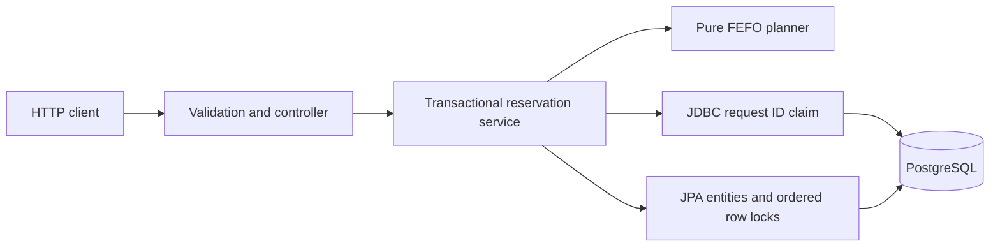
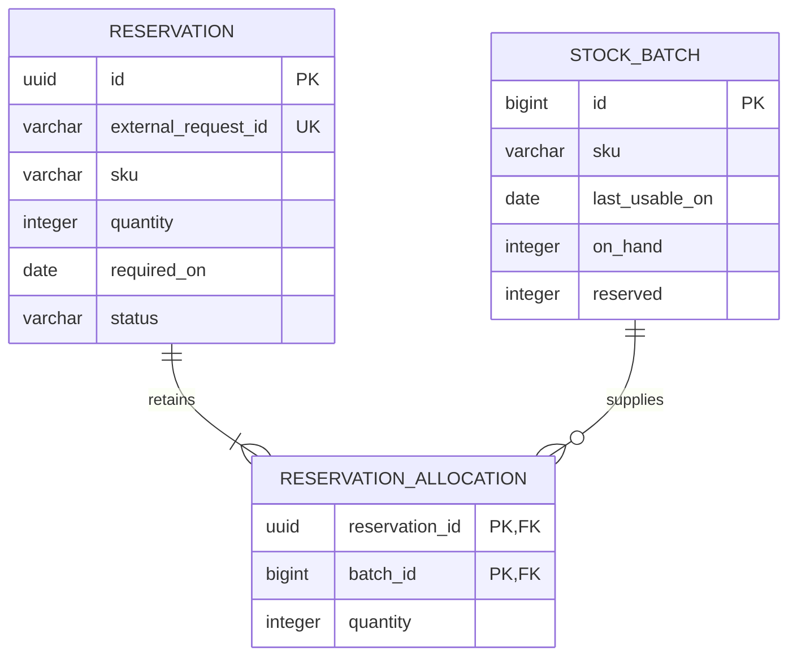

# Stock Reservation API

[](https://github.com/fullstack-nick/stock-reservation-api/actions/workflows/ci.yml)

A Java service that reserves grocery cases from suitable stock batches without allocating the same stock twice. Create a reservation, inspect it, or release it. Batches are chosen by **first expiry, first out (FEFO)**, with durable retries and atomic PostgreSQL transactions.

An independent educational project with fictional inventory. It runs locally and has no cloud deployment.

**Java 21 · Spring Boot 4.1.2 · Hibernate · PostgreSQL 18.6 · Flyway · Maven · Testcontainers**

## What this project practices

- **Domain logic:** a [pure allocation planner](src/main/java/io/github/fullstacknick/stockreservation/reservation/domain/AllocationPlanner.java), inclusive dates, deterministic ties, and overflow-safe totals.
- **Persistence:** three related tables, database constraints, explicit fetching, and JDBC/JPA writes in one transaction.
- **Concurrency:** [real PostgreSQL contention tests](src/test/java/io/github/fullstacknick/stockreservation/ReservationConcurrencyIT.java) observe blocked transactions before releasing locks.
- **Failure recovery:** [rollback after flushed writes](src/test/java/io/github/fullstacknick/stockreservation/ReservationRollbackIT.java), durable request IDs, and [application restart tests](src/test/java/io/github/fullstacknick/stockreservation/ReservationRestartIT.java).
- **Support:** correlated HTTP outcomes, reconciliation SQL, and a [reproduced lost-update incident](docs/incidents/0001-lost-update.md).

## Quick start

Install **JDK 21**, **Git**, and **Docker with Compose and a running Linux engine**. Maven and PostgreSQL do not need host installations. The first build downloads dependencies and the pinned database image. Allow ports **8080** and **5432** on loopback.

```text
git clone https://github.com/fullstack-nick/stock-reservation-api.git
cd stock-reservation-api
docker compose up -d --wait db
```

Windows PowerShell:

```powershell
.\mvnw.cmd spring-boot:run '-Dspring-boot.run.profiles=demo'
```

macOS / Linux:

```bash
./mvnw spring-boot:run -Dspring-boot.run.profiles=demo
```

The **demo clock is fixed at 2026-11-01T09:00:00Z** (Europe/Berlin). This keeps examples reproducible regardless of the real date. Startup logs make the fixed clock explicit. Normal mode uses the system clock and requires datasource configuration and separately supplied inventory.

In a second terminal, run the complete demonstration (PowerShell 7, also available on macOS/Linux):

```powershell
pwsh -File scripts/demo.ps1
```

It checks the 6+3 allocation, GET, creation replay, two releases, replay after release, and two competing apple requests. It generates fresh request IDs and releases its successful reservations, so it can run twice without resetting the database. Existing manual reservations may consume the demo stock; release them first.

Alternatively, use [the HTTP collection](requests/reservations.http), or send the first request with curl in a POSIX shell:

```bash
curl -i http://127.0.0.1:8080/reservations \
  -H 'Content-Type: application/json' \
  -d '{"externalRequestId":"ORDER-1042-L1","sku":"YOGURT-CASE","quantity":9,"requiredOn":"2026-11-02"}'
```

PowerShell equivalent:

```powershell
$body = @{ externalRequestId = 'ORDER-1042-L1'; sku = 'YOGURT-CASE'; quantity = 9; requiredOn = '2026-11-02' } | ConvertTo-Json
$reservation = Invoke-RestMethod http://127.0.0.1:8080/reservations -Method Post -ContentType application/json -Body $body
$reservation | ConvertTo-Json -Depth 5
# Keep the same body to replay; release restores availability.
Invoke-RestMethod "http://127.0.0.1:8080/reservations/$($reservation.id)/release" -Method Post
```

## A concrete allocation

For nine `YOGURT-CASE` cases required on **2026-11-02**:

| Batch | Last usable date | On hand | Allocation |
|---|---|---:|---:|
| A / 101 | 2026-11-03 | 6 | 6 |
| B / 102 | 2026-11-06 | 10 | 3 |
| C / 103 | 2026-10-31 | 5 | 0 — ineligible |

The first call returns `201 Created` and `Location: /reservations/{id}`:

```json
{
  "id": "c01ca834-3735-4e14-ab01-ab10edc01bf0",
  "externalRequestId": "ORDER-1042-L1",
  "sku": "YOGURT-CASE",
  "quantity": 9,
  "requiredOn": "2026-11-02",
  "status": "ACTIVE",
  "createdAt": "2026-11-01T09:00:00Z",
  "releasedAt": null,
  "allocations": [
    { "batchId": 101, "lastUsableOn": "2026-11-03", "quantity": 6 },
    { "batchId": 102, "lastUsableOn": "2026-11-06", "quantity": 3 }
  ]
}
```

The UUID is illustrative. Availability becomes 0 and 7; physical on-hand stock remains 6 and 10. Releasing restores availability and retains both allocation rows as history.

## Architecture and guarantees





One service transaction claims the external request ID, locks eligible batches in `(last_usable_on, id)` order, plans allocations, and writes all counters and allocation rows. JDBC and JPA share that transaction. The controller reports success only after commit. Release locks the reservation first, then its batches in the same order.

- Eligibility is inclusive: `lastUsableOn >= requiredOn`. New reservations must be for today or later in the warehouse zone.
- Creation is all or nothing. Insufficient stock leaves no durable request ID, so a later retry can succeed after availability changes.
- Identical successful IDs return `200` and the same reservation. Changed SKU, quantity, or required date returns `409 REQUEST_ID_CONFLICT`.
- Replay returns the **current state**, including `RELEASED`, and works after the original required date passes. It never creates a second allocation.
- Repeated release restores stock exactly once and preserves the first release timestamp. On network uncertainty, retry with the same identity.
- The [invariant query](docs/sql/check-invariants.sql) reconciles counters against active allocations, including batches with no allocations.

See the [architecture walkthrough](docs/architecture.md) and [consistency decision](docs/decisions/0001-reservation-consistency.md) for transaction boundaries, assumptions, and alternatives.

## HTTP contract

| Operation | Route | Success |
|---|---|---|
| Create / replay | `POST /reservations` | `201` new / `200` existing |
| Inspect | `GET /reservations/{id}` | `200` |
| Release, empty body | `POST /reservations/{id}/release` | `200`, including repeats |

Only `GET /actuator/health` is exposed for operations; it includes database health without internal details. Business responses use `Cache-Control: no-store`. Optional `X-Correlation-ID` accepts a canonical UUID; otherwise the service generates one and echoes it.

Errors use `application/problem+json`, a stable `code`, and `correlationId`: `400` for validation/malformed input; `404 RESERVATION_NOT_FOUND`; `409 INSUFFICIENT_STOCK` or `REQUEST_ID_CONFLICT`; `503 TEMPORARILY_UNAVAILABLE` with `Retry-After: 1`; safe `500 INTERNAL_ERROR` for unexpected defects. Standard `405`, `406`, and `415` errors follow the same format where negotiation permits.

Strings are case-sensitive and untrimmed, quantity is a positive JSON integer, and dates use exact `YYYY-MM-DD`. Unknown/duplicate properties and implicit numeric conversions are rejected. Full fields, examples, limits, headers, and statuses: [OpenAPI 3.1](docs/openapi.yaml).

## Verify

Keep Docker running. Compose and a manually started application are **not needed** for tests; Testcontainers owns isolated PostgreSQL databases.

```powershell
.\mvnw.cmd --batch-mode --no-transfer-progress verify
```

```bash
./mvnw --batch-mode --no-transfer-progress verify
```

`verify` runs unit/HTTP-slice tests and PostgreSQL integration tests, checks failures, builds the executable JAR, and creates `target/site/jacoco/index.html`. Surefire/Failsafe XML and text reports are under `target/surefire-reports/` and `target/failsafe-reports/`. `test` runs the faster unit/slice subset only. Database tests fail if Docker is unavailable.

The suite covers deterministic contention, duplicate claims, waiting after rollback, concurrent release, independent SKUs, timeout recovery, strict JSON, SQL constraints, midnight/DST boundaries, preserved seeds, and restart. [Verification evidence](docs/verification.md) records the completed local and CI checks. GitHub Actions runs the same `verify` command on Ubuntu with Java 21 and uploads reports for seven days.

After verification, run the packaged application against the Compose database:

```text
java -jar target/stock-reservation-api-1.0.0.jar --spring.profiles.active=demo
```

## Reviewer tour and support

1. Run the demo and inspect the 6+3 result and repeated release.
2. Read [ReservationService](src/main/java/io/github/fullstacknick/stockreservation/reservation/application/ReservationService.java) alongside [the consistency ADR](docs/decisions/0001-reservation-consistency.md).
3. Run the focused contention check: `./mvnw '-Dit.test=ReservationConcurrencyIT' verify` (Windows: `.\mvnw.cmd`).
4. Compare [rollback tests](src/test/java/io/github/fullstacknick/stockreservation/ReservationRollbackIT.java) with [counter reconciliation](docs/sql/check-invariants.sql).
5. Read the [lost-update exercise](docs/incidents/0001-lost-update.md), including real evidence and a short German handover.

Open SQL access with `docker compose exec db psql -U stock_reservation -d stock_reservation`. [Reservation inspection](docs/sql/inspect-reservation.sql) explains a request's stored history; [lock inspection](docs/sql/inspect-locks.sql) shows blocked sessions. See [operations](docs/operations.md) for runnable diagnostics, JSON logs, and troubleshooting.

## Configuration and limits

| Setting | Demo default |
|---|---|
| `APP_PORT` / `DB_PORT` | `8080` / `5432`, bound to `127.0.0.1` |
| `DB_USERNAME` / `DB_PASSWORD` | `stock_reservation` / `local-demo-only`, fictional local credentials |
| `warehouse.zone` | `Europe/Berlin` |
| `reservation.lock-timeout` / `statement-timeout` | `3s` / `10s` per lock wait / statement |
| `reservation.transaction-timeout-seconds` | `15` |
| Hikari pool / acquisition timeout | 10 connections / 5 seconds |

Compose reads an optional `.env` copied from [.env.example](.env.example); **Java does not read that file**. Export matching variables in the application terminal when changing ports or credentials. [Operations](docs/operations.md) gives both shell syntaxes and standard-mode setup. Changing initialization credentials does not update an existing database volume.

Stop the application with Ctrl+C. `docker compose down` stops the database and retains data. **`docker compose down --volumes` destroys this project's demo database**; use it only for an intentional fresh scenario, then start normally. Application restarts preserve reservations and never reset reserved counters.

Scope is one warehouse, one SKU per reservation, whole cases, immutable seeded inventory, and explicit release. There is no automatic expiry, inventory editing, authentication, UI, message broker, or deployment. Overlapping stock requests deliberately serialize; this project makes no throughput claim. Keep the unauthenticated application on loopback. The [implementation plan](IMPLEMENTATION_PLAN.md) records the design baseline and acceptance checks.

## License

[MIT](LICENSE) © 2026 Nick Petrushin.
